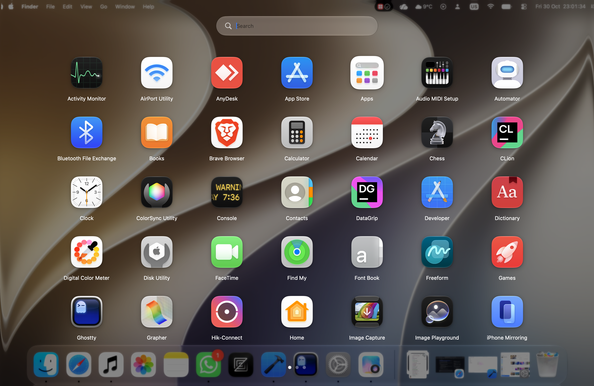
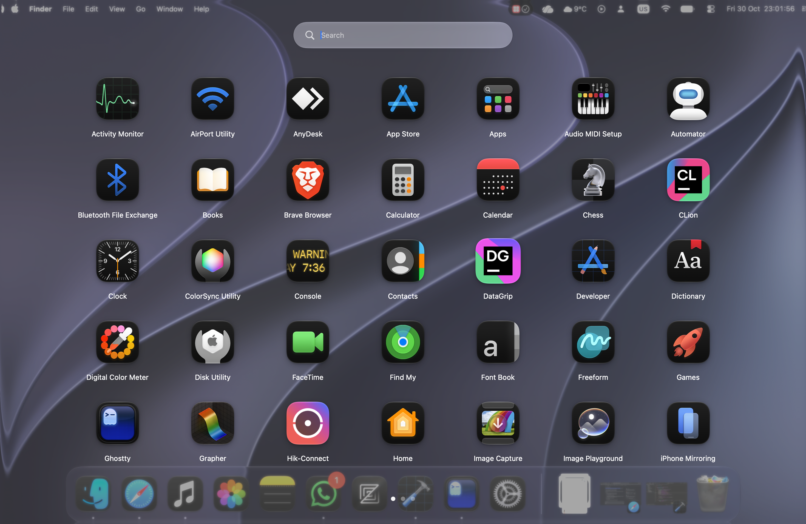
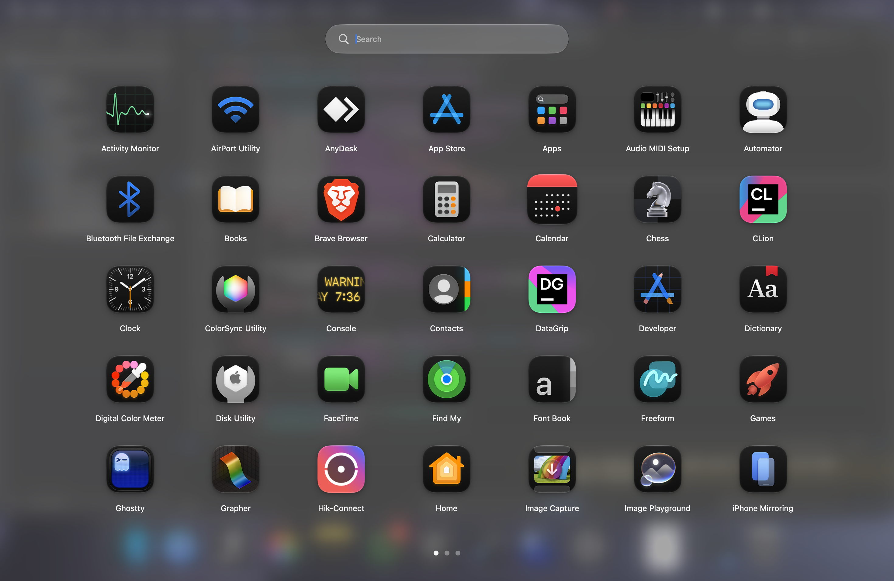
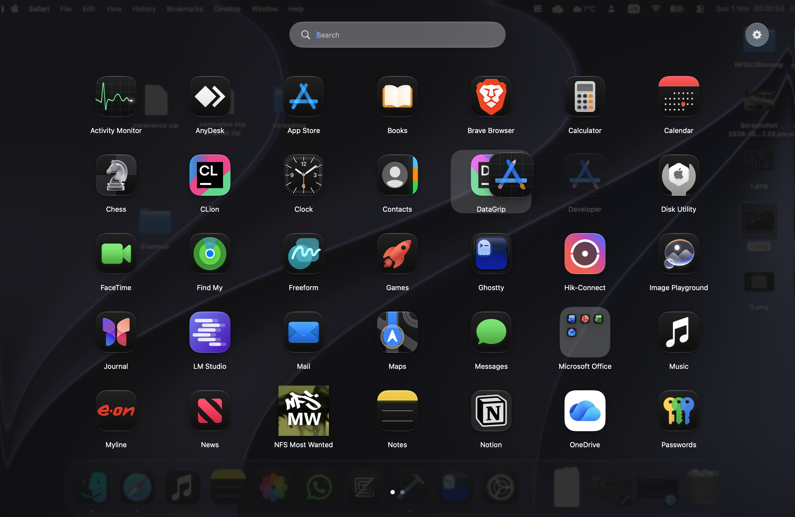
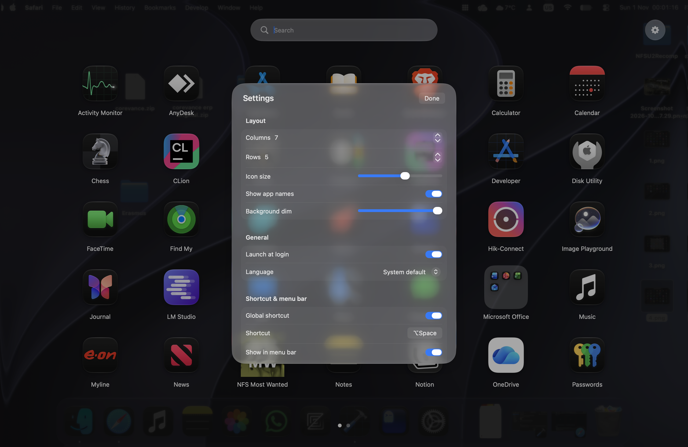
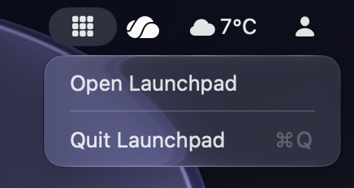

# <div align="center">

# Launchpad

**A reimplementation of the classic Launchpad for macOS Tahoe and Golden Gate.**

Fast, familiar, and native: your apps, one keystroke away.




</div>

---

## Why?

Apple removed Launchpad from recent versions of macOS in favor of the Apps view (which, in my experience, is kinda buggy). This project brings back the grid-of-apps experience you know, rebuilt from scratch for modern macOS.

## Screenshots

| Main grid | Search |
|:---:|:---:|
|  |  |
| *Your apps, paginated and sorted* | *Type to filter instantly* |

| Folders | Drag & drop |
|:---:|:---:|
|  |  |
| *Group apps, rename, reorder* | *Drop on an app to make a folder, on its side to reorder* |

| Settings | Menu bar |
|:---:|:---:|
|  |  |
| *Layout, shortcut, language, hidden apps* | *Know it's running, open or quit from the menu bar* |

## Features

- 🔲 **App grid**: all your installed apps in a paginated grid that automatically fits your screen
- 🔍 **Instant search**: start typing to filter (apps inside folders included), press <kbd>Return</kbd> to launch the first match
- 📈 **Smart ranking**: results are sorted by how well they match and how often you launch each app, and initials work too (`vsc` finds Visual Studio Code)
- ⌨️ **Full keyboard navigation**: move around the grid with the arrow keys, launch with <kbd>Return</kbd>, flip pages with <kbd>,</kbd> and <kbd>.</kbd>
- 🟢 **Running-app dots**: a small dot under the icon of every app that is currently open
- 🖥️ **Multi-display aware**: opens on the screen where your cursor is
- ♿ **Reduce Motion support**: follows the macOS accessibility setting and swaps animations for simple fades
- 📁 **Folders**: drop an app onto another to create one, rename it, reorder inside it, drag apps back out
- ✋ **Drag & drop**: reorder freely, hold a dragged app at the screen edge to flip pages
- 🙈 **Hide apps**: right-click → *Hide from Launchpad*, restore any time in Settings
- ⌨️ **Global shortcut**: open and close Launchpad from anywhere (<kbd>⌥</kbd><kbd>Space</kbd> by default, fully customizable)
- 🤏 **Pinch to open**: open Launchpad with the thumb-and-three-fingers pinch instead of macOS's Apps view
- 👋 **First-run guide**: a short tutorial on the first launch that also helps you set your shortcut and pinch gesture
- 🖥️ **Menu bar icon**: optional, so you can see it's running and open or quit it from there
- 🚀 **Launch at login**: starts silently in the background, ready for your shortcut
- ⚙️ **Layout settings**: columns, rows, icon size, background dim, show or hide app names
- 🌍 **Multilingual**: English, Română, Español, Français, Deutsch, Italiano, Nederlands, Português, 日本語, 简体中文, switchable in the app
- 🖱️ **Trackpad, Magic Mouse and wheel mouse**: swipe, scroll or click through pages
- 🪟 **Native look**: built to match the macOS Liquid Glass design language
- 🔒 **Private**: makes no network connections, has no analytics, everything stays on your Mac

## Requirements

- macOS 26 (Tahoe) or later
- Xcode 26+ (only if building from source)

## Installation

### Download

Grab the latest build from the [Releases](https://github.com/drclcomputers/Launchpad/releases) page, unzip it, and drag **Launchpad.app** into your `/Applications` folder.

> Builds are not signed or notarized (that needs a paid Apple Developer account), so macOS blocks the first launch. Right-click the app and choose **Open**, or run `xattr -cr /Applications/Launchpad.app` once.

### Build from source

```bash
git clone https://github.com/drclcomputers/Launchpad.git
cd Launchpad
open Launchpad.xcodeproj
```

Then select the **Launchpad** scheme and press <kbd>⌘</kbd> + <kbd>R</kbd>.

## Usage

| Action | How |
|---|---|
| Open / close Launchpad | Your global shortcut (<kbd>⌥</kbd><kbd>Space</kbd> by default), the menu bar icon, or the pinch gesture if enabled |
| Search | Just start typing |
| Move around the grid | Arrow keys (the page follows your selection) |
| Launch the selected app, or open the selected folder | <kbd>Return</kbd> |
| Launch the first search result | Type, then <kbd>Return</kbd> |
| Next / previous page | <kbd>.</kbd> / <kbd>,</kbd> (the <kbd>></kbd> / <kbd><</kbd> keys), swipe, mouse wheel, or vertical scroll |
| Create a folder | Drag an app onto the middle of another app |
| Reorder | Drag an app onto the left or right side of another |
| Change page while dragging | Hold the dragged app near the left or right screen edge |
| Take an app out of a folder | Drag it outside the folder panel, or right-click → *Remove from Folder* |
| Hide an app | Right-click → *Hide from Launchpad* |
| Open Settings | Gear button next to the search bar |
| Close | <kbd>Esc</kbd> (closes Settings or a folder first) or click the background |

## Keyboard shortcut

Launchpad registers a global shortcut by itself, with no extra permissions needed.

1. Open Launchpad and click the gear icon.
2. In **Shortcut & menu bar**, click the shortcut button and press the combination you want.
3. Press <kbd>Esc</kbd> to cancel. A shortcut must include at least one of <kbd>⌃</kbd>, <kbd>⌥</kbd> or <kbd>⌘</kbd>.

You can also turn the shortcut off completely with the **Global shortcut** switch.

> <kbd>⌥</kbd><kbd>Space</kbd> is also used by some other launchers and apps (for example the ChatGPT app). If it clashes, record a different combination.

The first time you open Launchpad, a short guide walks you through the basics and lets you set the shortcut. You can replay it any time from **Settings → About → Show welcome guide**.

## Pinch to open (optional)

Open Launchpad with the thumb-and-three-fingers pinch, the same gesture macOS uses for its own Apps view.

1. Turn it on in the welcome guide, or later in **Settings → Shortcut & menu bar → Pinch to open**.
2. Turn off the system pinch so macOS doesn't open its own Apps view as well. Click **Open Trackpad Settings** (in the guide or in Settings), then under *More Gestures* switch off the Launchpad/Apps pinch.
3. Pinch with your thumb and three fingers on the trackpad.

> Launchpad cannot intercept the system gesture, so it detects the pinch itself while you turn macOS's version off. The detection reads raw trackpad touches through a private macOS framework. That is why Launchpad is **not sandboxed**, and why it may stop working after a macOS update. It works with trackpads only (built-in or Magic Trackpad).

## Settings

| Setting | What it does |
|---|---|
| Columns / Rows | Size of the grid (4–10 columns, 3–7 rows) |
| Icon size | Icon size, automatically capped so everything fits your screen |
| Show app names | Show or hide the labels under icons |
| Background dim | How dark the overlay behind the grid is |
| Launch at login | Start Launchpad in the background when you log in |
| Language | System default, English, Română, Español, Français, Deutsch, Italiano, Nederlands, Português, 日本語, 简体中文 |
| Global shortcut | Enable, disable and record the shortcut |
| Show in menu bar | Show or hide the menu bar icon |
| Pinch to open | Open Launchpad with the thumb-and-three-fingers pinch, with a button that opens Trackpad settings so you can turn off macOS's own pinch |
| Hidden apps | See and unhide apps you hid |
| Reset layout | Remove all folders and custom ordering |
| Clear launch history | Forget how often you launched each app (resets search ranking) |
| About | Shows the app version and author, and replays the welcome guide |
| Quit Launchpad | Fully quit the app |

## Good to know

- **Launchpad keeps running in the background** after you close it, so reopening is instant. Quit it from the menu bar icon or from Settings.
- Apps are read from `/Applications`, `/System/Applications` and `~/Applications` (including one level of subfolders such as `Utilities`), and the list is refreshed every time you open Launchpad.
- Your layout, hidden apps, settings and launch counts are stored locally in the app's preferences. Nothing leaves your Mac.
- A dot under an icon means the app is running. It is read when Launchpad opens.
- Launchpad is **not sandboxed**: reading raw trackpad touches for the pinch gesture is not possible inside the App Sandbox. It still makes no network connections.

## Troubleshooting

- **The shortcut does nothing or clashes with another app:** record a different combination in Settings.
- **Launch at login doesn't stick:** move the app to `/Applications` and check *System Settings → General → Login Items & Extensions*.
- **Get Info does nothing:** allow Launchpad to control Finder under *System Settings → Privacy & Security → Automation*.
- **<kbd>,</kbd> and <kbd>.</kbd> don't flip pages:** they only work while the search field is empty and no folder is open, otherwise they are typed into the search.
- **Pinch to open does nothing:** make sure the switch is on in Settings, that you are using a trackpad, and that the app is really unsandboxed (`codesign -d --entitlements - /Applications/Launchpad.app` should not list `app-sandbox`).
- **Pinch to open also opens Apps:** turn off the Launchpad/Apps pinch in *System Settings → Trackpad → More Gestures*. The **Open Trackpad Settings** button takes you there.
- **An app is missing:** it probably lives outside the folders listed above, or it is hidden (check *Hidden apps* in Settings).

## Project structure

```
Launchpad/
├── Launchpad/
│   ├── Launchpadapp.swift       # App entry, overlay window, menu bar item
│   ├── Launchpadview.swift      # Grid, pages, search, folders, tiles
│   ├── Appstore.swift           # App scanning, layout, folders, hidden apps, search ranking
│   ├── Drag.swift               # In-app drag & drop
│   ├── HotKey.swift             # Global shortcut and recorder
│   ├── PinchGesture.swift       # Pinch-to-open detection
│   ├── Onboarding.swift         # First-run guide
│   ├── Settings.swift           # Settings panel, languages, launch at login
│   └── Localizable.xcstrings    # Translations
├── Launchpad.xcodeproj/
├── Launchpad.entitlements
└── LICENSE
```

## License

Released under the [MIT License](LICENSE).

## Acknowledgements

Inspired by Apple's original Launchpad. This project is not affiliated with or endorsed by Apple Inc.
